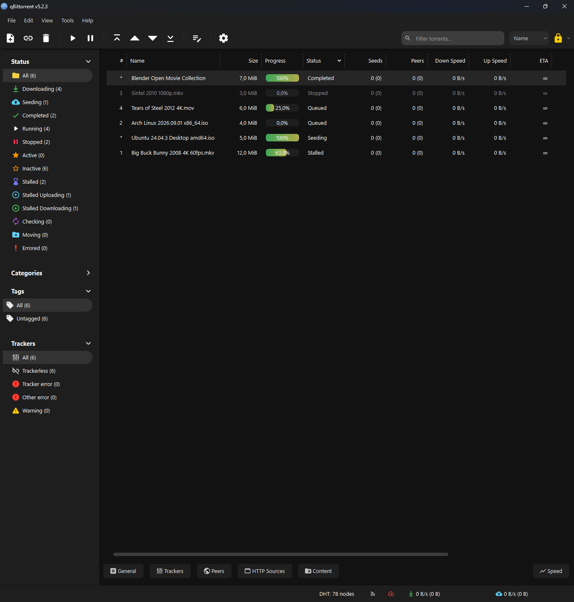

# Onyx — a qBittorrent theme

A dark qBittorrent theme built from the "qbittorent" concept
(`73065792-…png` in this folder). The menus and toolbar share one floating
rounded card. The sidebar and the torrent details panel are cards too, and all
of them sit on a near-black canvas with the transfer list. It has green gradient
progress bars, rounded row and pill-shaped selections, and colour-coded Material
icons in Apple's palette.



Tested on **qBittorrent 5.2.3 (Qt 6.10) on Windows 11**. It targets qBittorrent
5.x. It should also load on 4.6.x (also Qt 6), but that is untested.

## Install

1. Open qBittorrent → **Tools → Options → Behavior → Interface**.
2. Tick **Use custom UI Theme** and browse to **`Onyx.qbtheme`** in this folder.
3. In the same section, set **Style: System** and **Color scheme: Dark** (for a
   dark title bar). On Windows, qBittorrent 5.x defaults to *Fusion*, so pick
   System explicitly; see below.
4. Click **OK** and **restart qBittorrent**. Themes are only loaded at start-up.

If you delete or move `Onyx.qbtheme` later, qBittorrent falls back to its default look.

### Optional: closer to the concept

- *Options → Behavior → Transfer List → **Auto hide zero status filters***
  shortens the sidebar to the filters that have torrents, like the mock-up.
- Right-click the transfer-list header to hide columns you don't need.
- Drag the **Progress** column wider to get the concept's long bars.

## Style: System or Fusion

Both work, but **System** (the Windows 11 style) is recommended. It is the only
style whose menus and drop-down lists are true rounded popups. Under **Fusion**,
which is qBittorrent's default on Windows, popup windows are plain rectangles, so
menus and drop-downs come out with square corners.

## What can't be themed

- **Title bar / traffic lights**: the window frame belongs to the OS, so on
  Windows you get the Windows title bar.
- **Texts**: "Search…" is qBittorrent's "Filter torrents…" placeholder, and
  "Done" is the "Progress" column. Themes can't change strings.
- **Shared icons**: a theme gets one icon per id. The toolbar *Resume* button
  and the sidebar *Running* filter share one (white here). *Seeding* and the
  status-bar upload speed also share one (the blue cloud).
- **Lock button**: qBittorrent only shows it when the tray icon is enabled.
- **Details panel tab buttons** (General, Trackers, …) sit just below the details
  card rather than inside it. qBittorrent gives them no container a theme could
  draw as part of the card.
- **Row highlight, right end**: while the columns are wider than the list (it
  scrolls sideways), the row runs off the edge, so that end stays square.
- **Piece bars** (the *Progress* and *Availability* bars on the details panel's
  General tab): qBittorrent paints them itself as plain rectangles. A theme only
  sets their colours, so their corners can't be rounded.
- **First toolbar button inset**: the theme finds that button by its English
  text ("Open"). In other languages it sits about 6px closer to the card's left
  edge.
- **Progress percentages** are drawn in the transfer list's own font. Qt gives
  that label no font of its own, so it can't be bolder or larger than the row
  text. Its position in the bar is fixed too, so the theme centres the bar on
  the text instead.
- **Popup shadow**: under the System style, Qt adds its own faint drop shadow
  to menus and drop-downs (a light rim on the bottom/right edges on dark
  backgrounds), and a theme can't switch it off. Only the Fusion style avoids
  it, but Fusion popups can't have rounded corners.
- **Selected sidebar icons**: Qt blends every selected icon 30% toward the
  palette's highlight colour, and a theme cannot switch that off. The theme uses
  a light grey for it, so grey icons look unchanged and coloured ones get only
  marginally lighter.
- The per-torrent state icons in the Name column are hidden on purpose, to match
  the concept. Row colours still show state: grey for stopped, red for errors.

## Folder layout

```
Onyx.qbtheme          ready-to-load theme (what you select in qBittorrent)
source/
  stylesheet.qss      the Qt stylesheet (all layout / widget styling)
  config.json         palette + state colours read by qBittorrent
  icons/*.svg         replacement icons, named after qBittorrent's icon ids
  ui/*.svg            chevrons, check marks, etc. used by the stylesheet
  resources.qrc       generated file list for rcc
tools/
  make_icons.py       regenerates icons/ and ui/ from the mapping inside it
  build_theme.py      packs source/ into Onyx.qbtheme and verifies it
  material-icons/     Material Icons (Round) sources + Apache-2.0 LICENSE
```

## Editing the theme

- **Live editing, no build step**: in Options, select `source/config.json`
  instead of the `.qbtheme`. qBittorrent then loads the folder directly. Edit
  `stylesheet.qss` / `config.json` and restart qBittorrent to see changes.
- **Colours**: the palette and per-state row colours (`TransferList.*`) are in
  `config.json`. Widget colours are in `stylesheet.qss`; the token list at its
  top shows the main ones.
- **Icons**: change the mapping in `tools/make_icons.py`, then run
  `python tools/make_icons.py`.
- **Rebuild the .qbtheme**: `pip install PySide6-Essentials` (this provides
  Qt's `rcc`), then run `python tools/build_theme.py`.

Note for anyone building themes by hand: qBittorrent mounts a `.qbtheme` at
`:/uitheme` itself. The `.qrc` must therefore not add a `/uitheme` prefix,
despite what some guides say. Otherwise nothing loads.

## Credits

Icons are based on Google's [Material Icons](https://fonts.google.com/icons)
(Round), licensed under Apache 2.0 (see `tools/material-icons/LICENSE`).
The theme design follows the original qBittorrent concept image in this folder.
