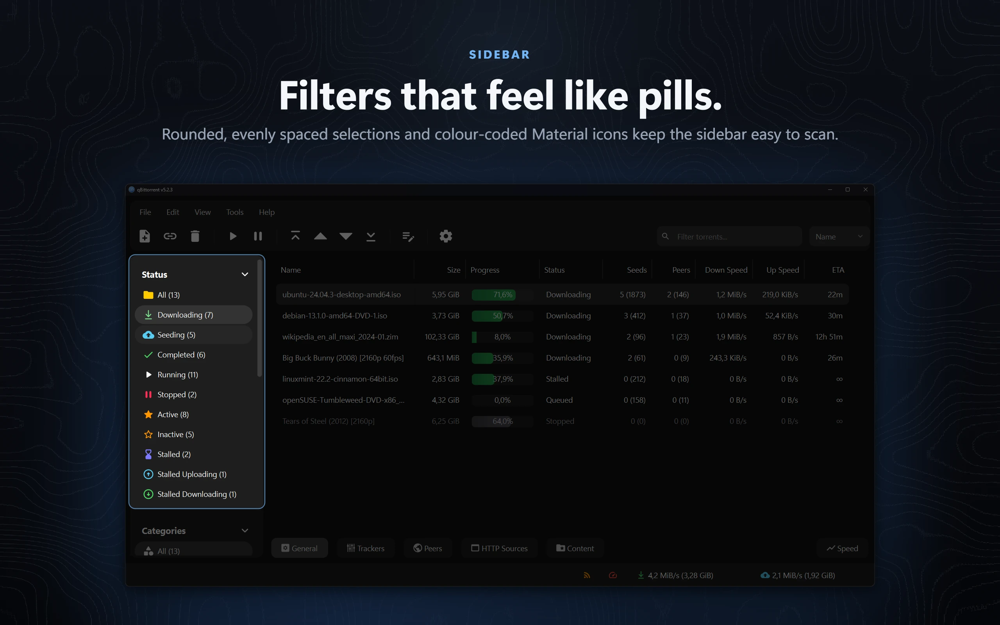
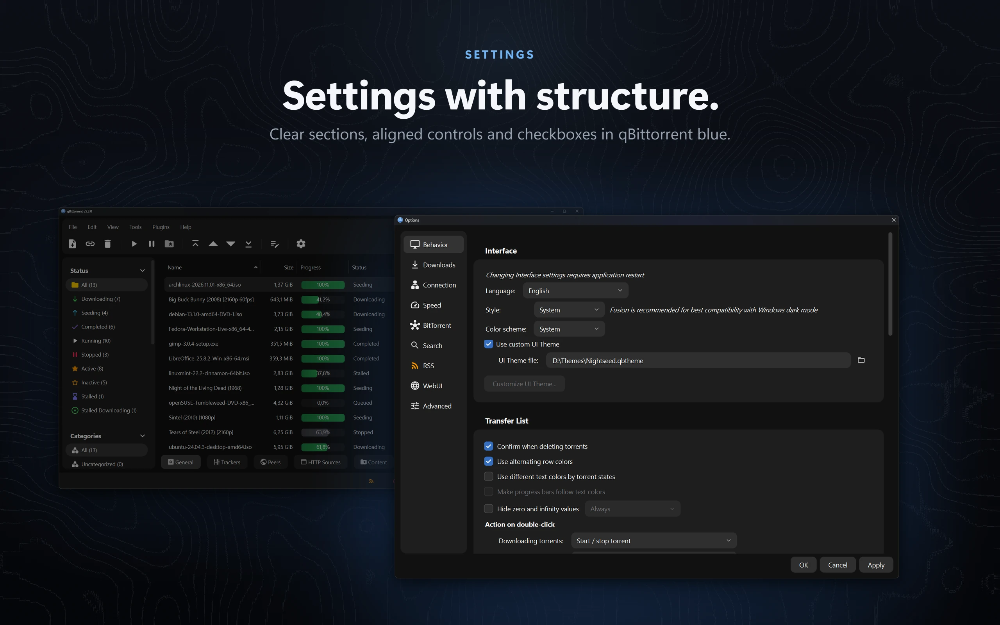
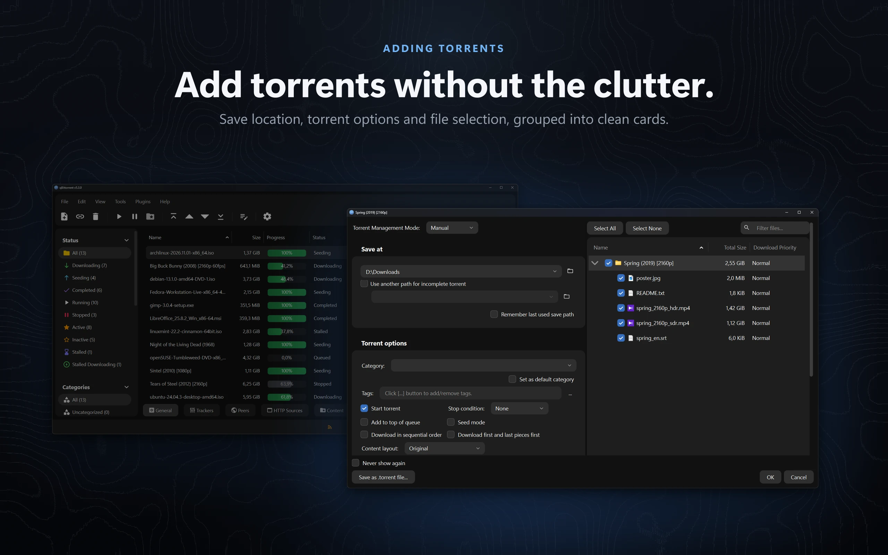
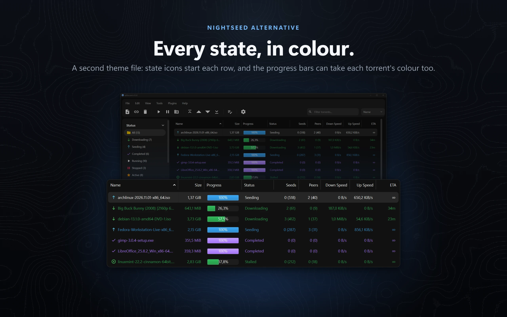
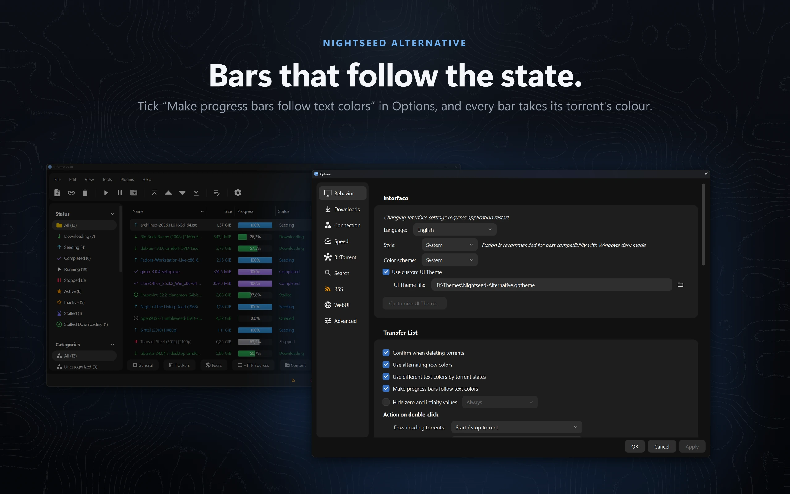

# Nightseed — a qBittorrent theme

A dark qBittorrent theme inspired by Ario Seno's
[Redesign Concept of Qbittorent](https://dribbble.com/shots/7841153-Redesign-Concept-of-Qbittorent)
on Dribbble. The menus and toolbar share one floating rounded card. The sidebar
and the torrent details panel are cards too, and all of them sit on a
near-black canvas with the transfer list. It has green gradient progress bars,
rows coloured by torrent state, rounded row and pill-shaped selections, and
colour-coded Material icons in Apple's palette.

Tested on **qBittorrent 5.3.0 (Qt 6.11) and 5.2.3 (Qt 6.10) on Windows 11**. It
targets qBittorrent 5.x. It should also load on 4.6.x (also Qt 6), but that is
untested.

## Screenshots

  
  
  
  
  
  

## Two versions

Each release has two theme files, built from the same source:

- **Nightseed** (`Nightseed.qbtheme`) is the theme in the screenshots above. Its
  rows are coloured by torrent state by default, and you can switch that off
  (step 5 of [Install](#install)). The transfer list screenshot shows both; the
  others have it off. The progress bars keep the theme's rounded green gradient
  whatever the state.
- **Nightseed Alternative** (`Nightseed-Alternative.qbtheme`) adds a state icon
  at the start of each row, and its progress bars can take each state's colour
  too (step 5 of [Install](#install)). For that, qBittorrent draws the bars itself:
  they have smaller corners and a thin outline, in the transfer list and in file
  lists. Downloading and seeding rows use a slightly darker green and blue, so
  the percentage stays readable on a coloured bar.

  
  

## Install

1. Download [**Nightseed.qbtheme**](https://github.com/Xtenso/qbittorrent-theme/releases/latest/download/Nightseed.qbtheme)
   or [**Nightseed-Alternative.qbtheme**](https://github.com/Xtenso/qbittorrent-theme/releases/latest/download/Nightseed-Alternative.qbtheme)
   from the latest release (see [Two versions](#two-versions)).
2. Open qBittorrent → **Tools → Options → Behavior → Interface**.
3. Tick **Use custom UI Theme** and browse to the downloaded **`.qbtheme`** file.
4. In the same section, set **Style: System** (recommended) and **Color scheme:
   Dark** (for a dark title bar).
   - **Fusion** works too, and qBittorrent itself recommends it for Windows dark
     mode, but with this theme its menus and drop-down lists have square corners.
5. On the same page, under **Transfer List**, keep **Use different text colors by
   torrent states** ticked (it is by default). Each row is then coloured by its
   torrent's state: green downloading, blue seeding, purple completed, grey
   stopped, red errored. Untick it for plain white rows.
   - **Make progress bars follow text colors**, just below it: with **Nightseed
     Alternative**, tick it to colour the bars by state too. With **Nightseed**
     it does nothing, and the bars stay green (grey when stopped or errored). See
     [Known limitations](#known-limitations).
   - Both settings are new in qBittorrent 5.2. Older versions always colour the
     rows and never the bars.
6. Click **OK** and **restart qBittorrent**. Themes are only loaded at start-up.

If you delete or move the theme file later, qBittorrent falls back to its default look.

## Known limitations

- **Progress bar colours**: in **Nightseed** the bars stay green whatever the
  torrent's state (grey when stopped or errored). qBittorrent's *Make progress
  bars follow text colors* only works when Qt draws the bars itself, and a theme
  can't tell whether you ticked it. So a theme that supports it gets Qt's plainer
  bars for everyone, ticked or not. That is the trade-off **Nightseed Alternative**
  makes: without the tick, its bars are plain green, stopped and errored ones too.
- **State icons** in the Name column are hidden on purpose in **Nightseed**, and
  row colours show the state instead. **Nightseed Alternative** shows them.
- **Shared icons**: a theme gets one icon per id. The toolbar *Resume* button
  and the sidebar *Running* filter share one (white here). *Downloading* and
  *Seeding* share theirs with the status bar's download and upload speeds (the
  green and blue arrows).
- **Details panel tab buttons** (General, Trackers, …) sit just below the details
  card rather than inside it. qBittorrent gives them no container a theme could
  draw as part of the card.
- **Piece bars** (the *Progress* and *Availability* bars on the details panel's
  General tab): qBittorrent paints them itself as plain rectangles. A theme only
  sets their colours, so their corners can't be rounded.
- **Row highlight, right end**: while the columns are wider than the list (it
  scrolls sideways), the row runs off the edge, so that end stays square.
- **First toolbar button inset**: the theme finds that button by its English
  text ("Open"). In other languages it sits about 6px closer to the card's left
  edge.

## License and credits

Nightseed is released under the [MIT License](LICENSE).

Icons are based on Google's [Material Icons](https://fonts.google.com/icons)
(Round), licensed under Apache 2.0 (see `tools/material-icons/LICENSE`).

Nightseed was inspired by
[Redesign Concept of Qbittorent](https://dribbble.com/shots/7841153-Redesign-Concept-of-Qbittorent)
by [Ario Seno](https://dribbble.com/ariosenodsgn) on Dribbble.
