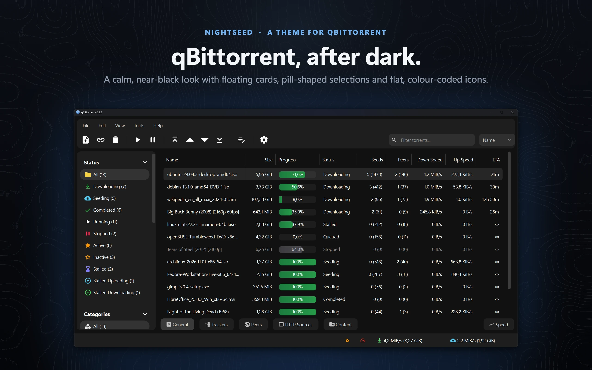
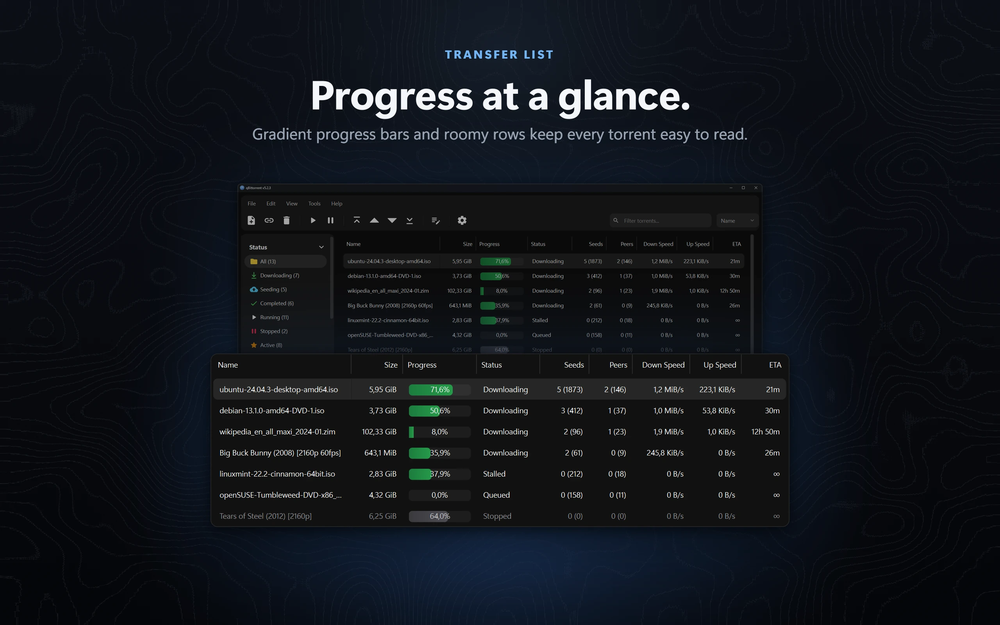
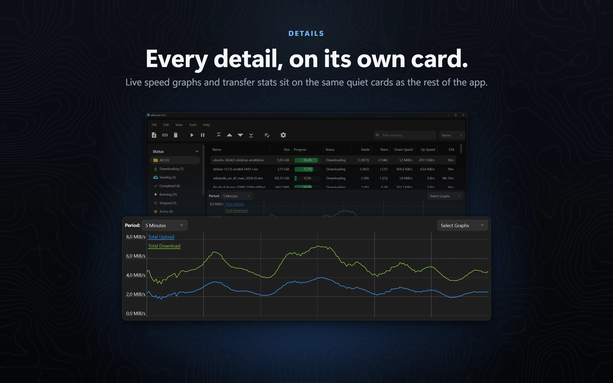
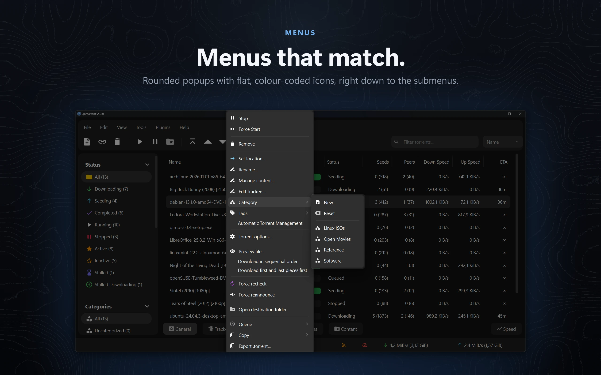

# Nightseed — a qBittorrent theme

A dark qBittorrent theme inspired by Ario Seno's
[Redesign Concept of Qbittorent](https://dribbble.com/shots/7841153-Redesign-Concept-of-Qbittorent)
on Dribbble. The menus and toolbar share one floating rounded card. The sidebar
and the torrent details panel are cards too, and all of them sit on a
near-black canvas with the transfer list. It has green gradient progress bars,
rounded row and pill-shaped selections, and colour-coded Material icons in
Apple's palette.

Tested on **qBittorrent 5.2.3 (Qt 6.10) on Windows 11**. It targets qBittorrent
5.x. It should also load on 4.6.x (also Qt 6), but that is untested.

## Screenshots

  
  
  
  
  
  

## Install

1. Download [**Nightseed.qbtheme**](https://github.com/Xtenso/qbittorrent-theme/releases/latest/download/Nightseed.qbtheme)
   from the latest release.
2. Open qBittorrent → **Tools → Options → Behavior → Interface**.
3. Tick **Use custom UI Theme** and browse to the downloaded **`Nightseed.qbtheme`**.
4. In the same section, set **Style: System** (recommended) and **Color scheme:
   Dark** (for a dark title bar).
   - **Fusion** works too, and qBittorrent itself recommends it for Windows dark
     mode, but with this theme its menus and drop-down lists have square corners.
5. Click **OK** and **restart qBittorrent**. Themes are only loaded at start-up.

If you delete or move `Nightseed.qbtheme` later, qBittorrent falls back to its default look.

## Known limitations

- **State icons** in the Name column are hidden on purpose. Row colours show
  state instead: grey for stopped, red for errors.
- **Shared icons**: a theme gets one icon per id. The toolbar *Resume* button
  and the sidebar *Running* filter share one (white here). *Seeding* and the
  status-bar upload speed also share one (the blue cloud).
- **Details panel tab buttons** (General, Trackers, …) sit just below the details
  card rather than inside it. qBittorrent gives them no container a theme could
  draw as part of the card.
- **Piece bars** (the *Progress* and *Availability* bars on the details panel's
  General tab): qBittorrent paints them itself as plain rectangles. A theme only
  sets their colours, so their corners can't be rounded.
- **Row highlight, right end**: while the columns are wider than the list (it
  scrolls sideways), the row runs off the edge, so that end stays square.
- **First toolbar button inset**: the theme finds that button by its English
  text ("Open"). In other languages it sits about 6px closer to the card's left
  edge.

## License and credits

Nightseed is released under the [MIT License](LICENSE).

Icons are based on Google's [Material Icons](https://fonts.google.com/icons)
(Round), licensed under Apache 2.0 (see `tools/material-icons/LICENSE`).

Nightseed was inspired by
[Redesign Concept of Qbittorent](https://dribbble.com/shots/7841153-Redesign-Concept-of-Qbittorent)
by [Ario Seno](https://dribbble.com/ariosenodsgn) on Dribbble.
